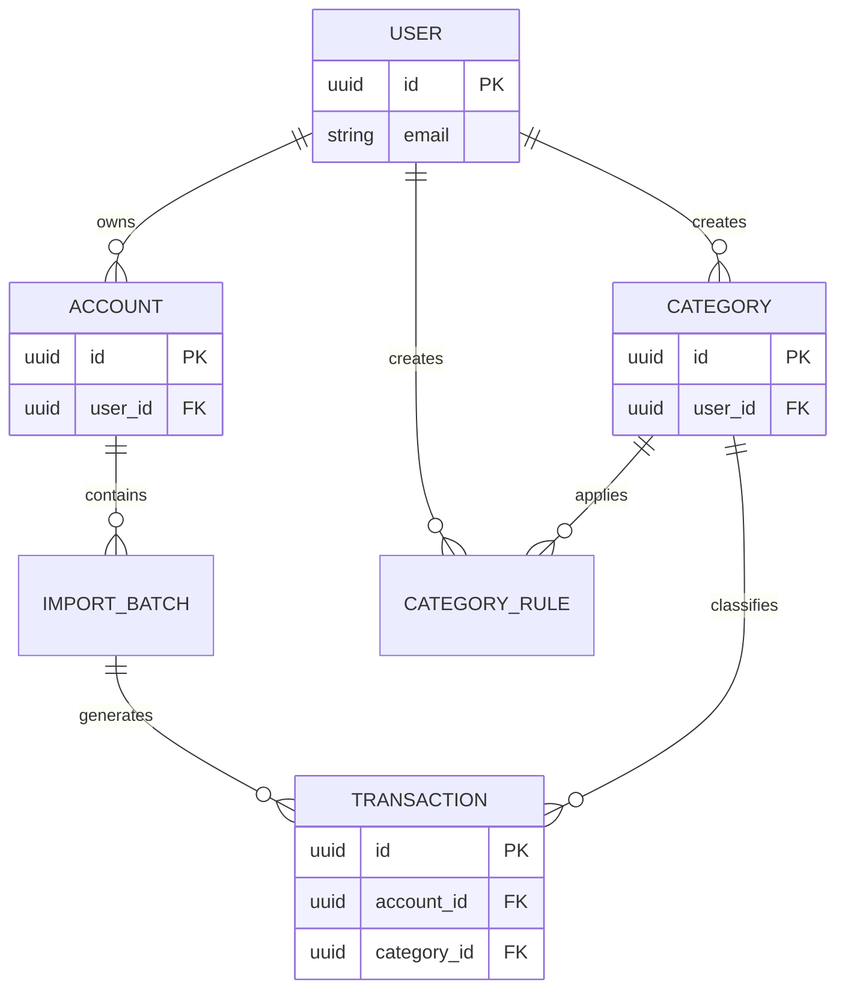

# 02 - Database Design

## 1. Overview

### 1.1 Purpose

This document describes the database design for the Personal Finance Management System.

The database is responsible for:

* Managing users
* Managing financial accounts
* Importing transaction data from bank files
* Storing income and expense transactions
* Categorizing transactions
* Supporting financial reports and analytics

---

## 2. Database Technology

| Item        | Description                       |
| ----------- | --------------------------------- |
| Database    | PostgreSQL                        |
| ORM         | Prisma                            |
| Primary Key | UUID                              |
| Timezone    | UTC                               |
| Currency    | VND (support extension in future) |

---

# 3. Database Design Principles

## 3.1 Primary Key

All tables use UUID as primary key.

Example:

```
id UUID PRIMARY KEY
```

Reason:

* Avoid exposing sequential IDs
* Easier distributed system support
* Better compatibility with future microservices

---

## 3.2 Timestamp

All tables should contain:

```
created_at TIMESTAMP
updated_at TIMESTAMP
```

Purpose:

* Audit history
* Data tracking
* Debugging

---

# 4. Entity Relationship Diagram (ERD)



---

# 5. Table Design

# 5.1 users

## Purpose

Store system users.

## Columns

| Column        | Type         | Constraint | Description        |
| ------------- | ------------ | ---------- | ------------------ |
| id            | UUID         | PK         | User identifier    |
| email         | VARCHAR(255) | UNIQUE     | Login email        |
| password_hash | VARCHAR(255) | NOT NULL   | Encrypted password |
| created_at    | TIMESTAMP    | NOT NULL   | Created time       |
| updated_at    | TIMESTAMP    | NOT NULL   | Updated time       |

---

# 5.2 accounts

## Purpose

Store user's financial accounts.

Examples:

* Bank account
* Cash wallet
* Credit card

## Columns

| Column         | Type         | Constraint  | Description    |
| -------------- | ------------ | ----------- | -------------- |
| id             | UUID         | PK          | Account ID     |
| user_id        | UUID         | FK          | Owner          |
| name           | VARCHAR(100) | NOT NULL    | Account name   |
| bank_name      | VARCHAR(100) | NULL        | Bank provider  |
| account_number | VARCHAR(50)  | NULL        | Account number |
| account_type   | ENUM         | NOT NULL    | Account type   |
| currency       | VARCHAR(10)  | DEFAULT VND | Currency       |
| created_at     | TIMESTAMP    |             | Created time   |
| updated_at     | TIMESTAMP    |             | Updated time   |

## Account Type

```
BANK
CASH
CREDIT_CARD
OTHER
```

---

# 5.3 import_batches

## Purpose

Store information about imported bank transaction files.

This table helps:

* Track import history
* Avoid duplicated imports
* Audit uploaded files

## Columns

| Column      | Type         | Constraint |
| ----------- | ------------ | ---------- |
| id          | UUID         | PK         |
| account_id  | UUID         | FK         |
| file_name   | VARCHAR(255) | NOT NULL   |
| file_type   | VARCHAR(20)  | NOT NULL   |
| status      | ENUM         | NOT NULL   |
| imported_at | TIMESTAMP    |            |

## Import Status

```
PENDING
PROCESSING
SUCCESS
FAILED
```

---

# 5.4 transactions

## Purpose

Core table storing all financial transactions.

This table stores:

* Original transaction data imported from banks
* User-created manual transactions
* Normalized transaction information for analytics
* User-defined metadata such as notes and categories

---

## Columns

| Column                  | Type          | Constraint   | Description                                                         |
| ----------------------- | ------------- | ------------ | ------------------------------------------------------------------- |
| id                      | UUID          | PK           | Transaction identifier                                              |
| account_id              | UUID          | FK, NOT NULL | Related financial account                                           |
| import_batch_id         | UUID          | FK, NULL     | Source import batch. NULL for manual transactions                   |
| category_id             | UUID          | FK, NULL     | Transaction category                                                |
| transfer_transaction_id | UUID          | FK, NULL     | Reference to related transaction when transferring between accounts |
| transaction_date        | DATE          | NOT NULL     | Transaction business date                                           |
| transaction_time        | TIME          | NULL         | Exact transaction time if provided by bank                          |
| description             | TEXT          | NOT NULL     | Original transaction description from bank                          |
| note                    | TEXT          | NULL         | User-defined note                                                   |
| merchant_name           | VARCHAR(255)  | NULL         | Normalized merchant or receiver name                                |
| amount                  | DECIMAL(15,2) | NOT NULL     | Transaction amount                                                  |
| currency                | VARCHAR(10)   | DEFAULT VND  | Transaction currency                                                |
| balance_after           | DECIMAL(15,2) | NULL         | Account balance after transaction                                   |
| reference_code          | VARCHAR(100)  | NULL         | Bank transaction identifier                                         |
| transaction_type        | ENUM          | NOT NULL     | Financial transaction type                                          |
| transaction_source      | ENUM          | NOT NULL     | Source of transaction data                                          |
| created_at              | TIMESTAMP     | NOT NULL     | Created timestamp                                                   |
| updated_at              | TIMESTAMP     | NOT NULL     | Updated timestamp                                                   |

---

## Transaction Type

Defines the financial behavior of the transaction.

Values:

```text
INCOME
EXPENSE
TRANSFER
```

Examples:

| Type     | Example                     |
| -------- | --------------------------- |
| INCOME   | Salary received             |
| EXPENSE  | Food, shopping, bills       |
| TRANSFER | Move money between accounts |

---

## Transaction Source

Defines how transaction data was created.

Values:

```text
BANK_IMPORT
MANUAL
```

Future extensions:

```text
API_SYNC
CSV_IMPORT
```

Examples:

| Source      | Description                  |
| ----------- | ---------------------------- |
| BANK_IMPORT | Imported from bank statement |
| MANUAL      | Created manually by user     |

---

## Field Details

### transaction_date

The business date of the transaction.

Example:

```
2026-07-10
```

Used for:

* Filtering transactions
* Monthly reports
* Expense analysis

---

### transaction_time

The exact execution time if provided by the bank.

Example:

```
14:35:21
```

Some banks only provide transaction date, therefore this field can be nullable.

Used for:

* Transaction ordering
* Detailed history

---

### description

Original description from bank.

Example:

```text
POS GRAB FOOD HCM
CK NGUYEN VAN A
LUONG THANG 07
```

Rules:

* Keep original value from source
* Do not overwrite during normalization

Used for:

* Transaction verification
* Auto categorization

---

### note

User-defined additional information.

Example:

```text
Dinner with team
Birthday gift
```

Difference:

| Field       | Source | Editable |
| ----------- | ------ | -------- |
| description | Bank   | No       |
| note        | User   | Yes      |

---

### balance_after

Remaining account balance after transaction.

Example:

```
Before:
10,000,000

Transaction:
-200,000

After:
9,800,000
```

Useful for:

* Balance verification
* Detecting import errors

---

### reference_code

Bank transaction identifier.

Example:

```
FT250711123456
```

Used for:

* Duplicate detection
* Transaction lookup

---

### merchant_name

Normalized merchant or receiver name.

Example:

Original:

```text
GRAB FOOD HCM 12345
```

Normalized:

```text
Grab
```

Used for:

* Merchant statistics
* Spending analysis

---

## Duplicate Detection Strategy

A transaction is considered duplicated when:

```
account_id
+
transaction_date
+
amount
+
reference_code
```

match an existing record.

---

## Example Data

| Date       | Time  | Description   | Amount   | Type    | Note           |
| ---------- | ----- | ------------- | -------- | ------- | -------------- |
| 2026-07-10 | 12:30 | GRAB FOOD HCM | -120000  | EXPENSE | Lunch          |
| 2026-07-01 | 09:00 | SALARY JULY   | 15000000 | INCOME  | Monthly salary |

# Index Strategy

Recommended indexes:

## Transaction date filtering

Common query:

```sql
WHERE transaction_date BETWEEN start_date AND end_date
```

Index:

```sql
CREATE INDEX idx_transaction_date
ON transactions(transaction_date);
```

---

## Account transaction lookup

Common query:

```sql
WHERE account_id = ?
```

Index:

```sql
CREATE INDEX idx_transaction_account
ON transactions(account_id);
```

---

## Reference lookup

Used for duplicate detection:

```sql
WHERE reference_code = ?
```

Index:

```sql
CREATE INDEX idx_transaction_reference_code
ON transactions(reference_code);
```

---

## Category reporting

Common query:

```sql
WHERE category_id = ?
```

Index:

```sql
CREATE INDEX idx_transaction_category
ON transactions(category_id);
```

---

## Design Decision

### Included in MVP

| Requirement                 | Fields                                       |
| --------------------------- | -------------------------------------------- |
| Bank transaction import     | import_batch_id, reference_code, description |
| Manual transaction creation | transaction_source, note                     |
| Financial statistics        | transaction_date, amount                     |
| Category analysis           | category_id                                  |
| Merchant analysis           | merchant_name                                |

### Future Extension

| Feature                   | Field                 |
| ------------------------- | --------------------- |
| Refund tracking           | parent_transaction_id |
| Transaction approval flow | status                |
| Recurring transactions    | recurring_rule_id     |

# 5.5 categories

## Purpose

Store transaction categories.

Examples:

```
Food
 ├── Restaurant
 └── Coffee

Transport
 ├── Grab
 └── Fuel
```

## Columns

| Column     | Type         | Constraint |
| ---------- | ------------ | ---------- |
| id         | UUID         | PK         |
| user_id    | UUID         | FK         |
| name       | VARCHAR(100) | NOT NULL   |
| parent_id  | UUID         | NULL       |
| icon       | VARCHAR(100) | NULL       |
| created_at | TIMESTAMP    |            |
| updated_at | TIMESTAMP    |            |

---

# 5.6 category_rules

## Purpose

Automatically classify transactions based on description.

Example:

Transaction:

```
GRAB FOOD HCM
```

Rule:

```
keyword = GRAB
category = Food
```

## Columns

| Column      | Type         | Constraint |
| ----------- | ------------ | ---------- |
| id          | UUID         | PK         |
| user_id     | UUID         | FK         |
| keyword     | VARCHAR(100) | NOT NULL   |
| category_id | UUID         | FK         |
| priority    | INT          | DEFAULT 0  |
| created_at  | TIMESTAMP    |            |

---

# 6. Relationship Definition

## User - Account

Relationship:

```
One User has many Accounts
```

Foreign key:

```
accounts.user_id -> users.id
```

---

## Account - Transaction

Relationship:

```
One Account has many Transactions
```

Foreign key:

```
transactions.account_id -> accounts.id
```

---

## Category - Transaction

Relationship:

```
One Category has many Transactions
```

Foreign key:

```
transactions.category_id -> categories.id
```

---

# 7. Index Strategy

Indexes are created based on common query patterns.

## Transaction filtering

Common query:

```sql
WHERE transaction_date BETWEEN start_date AND end_date
```

Index:

```sql
CREATE INDEX idx_transaction_date
ON transactions(transaction_date);
```

---

## Account transaction lookup

Query:

```sql
WHERE account_id = ?
```

Index:

```sql
CREATE INDEX idx_transaction_account
ON transactions(account_id);
```

---

## Category filtering

Query:

```sql
WHERE category_id = ?
```

Index:

```sql
CREATE INDEX idx_transaction_category
ON transactions(category_id);
```

---

# 8. Data Constraints

## Transaction amount

Use:

```
DECIMAL(15,2)
```

Do not use:

```
FLOAT
```

Reason:

Financial values require accuracy.

---

## Required fields

Transaction requires:

```
transaction_date
amount
description
account_id
```

---

# 9. Data Import Flow

```
Bank CSV File

      |
      v

Import Batch

      |
      v

Transaction Processing

      |
      v

Category Matching

      |
      v

Dashboard Statistics
```

---

# 10. Future Extension

The following features are not included in MVP:

* Monthly budget
* Saving goals
* Investment tracking
* Recurring transactions
* Multi-currency support
* AI transaction categorization
* Shared family wallet

---

# 11. Database Migration

Database changes must be managed through Prisma migration.

Flow:

```
Update schema.prisma

        |

prisma migrate dev

        |

PostgreSQL update
```

---

# 12. Open Questions

Before implementation:

* Authentication method (Email / OAuth)
* Bank file formats supported
* Transaction duplicate detection strategy
* Category auto-matching algorithm
* Data retention policy
