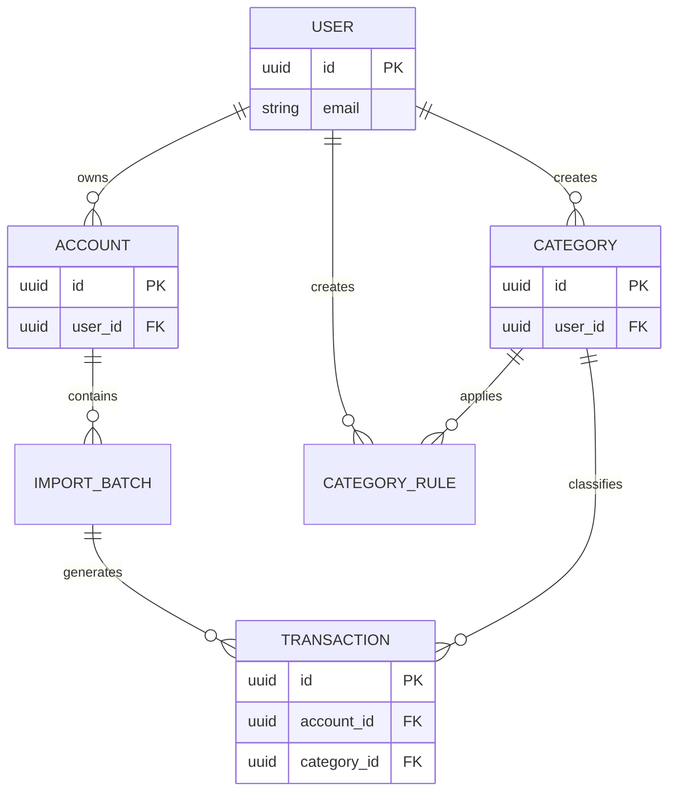

# 02 - Database Design

## 1. Overview

### 1.1 Purpose

This document describes the database design for the Personal Finance Management System.

The database is responsible for:

* Managing users
* Managing financial accounts
* Importing transaction data from bank files
* Storing income and expense transactions
* Categorizing transactions
* Supporting financial reports and analytics

---

## 2. Database Technology

| Item        | Description                       |
| ----------- | --------------------------------- |
| Database    | PostgreSQL                        |
| ORM         | Prisma                            |
| Primary Key | UUID                              |
| Timezone    | UTC                               |
| Currency    | VND (support extension in future) |

---

# 3. Database Design Principles

## 3.1 Primary Key

All tables use UUID as primary key.

Example:

```
id UUID PRIMARY KEY
```

Reason:

* Avoid exposing sequential IDs
* Easier distributed system support
* Better compatibility with future microservices

---

## 3.2 Timestamp

All tables should contain:

```
created_at TIMESTAMP
updated_at TIMESTAMP
```

Purpose:

* Audit history
* Data tracking
* Debugging

---

# 4. Entity Relationship Diagram (ERD)



---

# 5. Table Design

# 5.1 users

## Purpose

Store system users.

## Columns

| Column        | Type         | Constraint | Description        |
| ------------- | ------------ | ---------- | ------------------ |
| id            | UUID         | PK         | User identifier    |
| email         | VARCHAR(255) | UNIQUE     | Login email        |
| password_hash | VARCHAR(255) | NOT NULL   | Encrypted password |
| created_at    | TIMESTAMP    | NOT NULL   | Created time       |
| updated_at    | TIMESTAMP    | NOT NULL   | Updated time       |

---

# 5.2 accounts

## Purpose

Store user's financial accounts used to record financial transactions.

An account represents a source or destination of money, such as:

* Bank account
* Cash
* E-wallet
* Credit card

---

## Columns

| Column         | Type         | Constraint   | Description                        |
| -------------- | ------------ | ------------ | ---------------------------------- |
| id             | UUID         | PK           | Account identifier                 |
| user_id        | UUID         | FK, NOT NULL | Owner of the account               |
| name           | VARCHAR(100) | NOT NULL     | Display name of the account        |
| account_type   | ENUM         | NOT NULL     | Type of financial account          |
| bank_name      | VARCHAR(100) | NULL         | Bank or financial institution name |
| bank_code      | VARCHAR(20)  | NULL         | Bank code (e.g. VCB, TCB, ACB)     |
| account_number | VARCHAR(50)  | NULL         | Bank account number                |
| currency       | VARCHAR(10)  | NOT NULL     | Currency used by the account       |
| status         | ENUM         | NOT NULL     | Current account status             |
| created_at     | TIMESTAMP    | NOT NULL     | Created timestamp                  |
| updated_at     | TIMESTAMP    | NOT NULL     | Updated timestamp                  |

---

## Account Type

Defines the type of financial account.

Values:

```text
BANK
CASH
WALLET
CREDIT_CARD
OTHER
```

Examples:

| Type        | Example                  |
| ----------- | ------------------------ |
| BANK        | Vietcombank, Techcombank |
| CASH        | Cash in wallet           |
| WALLET      | MoMo, ZaloPay, ShopeePay |
| CREDIT_CARD | Visa Credit Card         |
| OTHER       | Other financial accounts |

---

## Account Status

Defines whether the account is currently in use.

Values:

```text
ACTIVE
INACTIVE
```

Examples:

| Status   | Description                                                   |
| -------- | ------------------------------------------------------------- |
| ACTIVE   | Account is available for normal use                           |
| INACTIVE | Account is no longer used but transaction history is retained |

---

## Field Details

### name

User-friendly name displayed throughout the application.

Examples:

```text
Techcombank Payroll
Cash Wallet
MoMo
```

---

### account_type

Determines the behavior and presentation of the account.

This field is used for:

* Filtering accounts
* Dashboard grouping
* Future business rules

---

### bank_name

Stores the full name of the bank or financial institution.

Examples:

```text
Vietcombank
Techcombank
MB Bank
```

This field may be NULL for non-bank accounts such as Cash or E-wallet.

---

### bank_code

Stores a short identifier of the bank.

Examples:

```text
VCB
TCB
MBB
ACB
```

Used for:

* Bank identification
* Future integrations
* Import mapping

This field may be NULL for non-bank accounts.

---

### account_number

Stores the bank account number when applicable.

Examples:

```text
0123456789
123456789012
```

This field is optional because:

* Cash accounts do not have an account number.
* Some e-wallets may not expose an account number.

---

### currency

Currency used by the account.

Default currency for MVP:

```text
VND
```

Future versions may support:

```text
USD
EUR
JPY
```

---

### status

Accounts should not be physically deleted because they may have existing transactions.

Instead, an account should be marked as **INACTIVE** when it is no longer used.

This preserves transaction history while preventing new transactions from being created.

---

## Design Decisions

### Included in MVP

| Requirement                  | Fields                               |
| ---------------------------- | ------------------------------------ |
| Multiple financial accounts  | account_type                         |
| Support bank accounts        | bank_name, bank_code, account_number |
| Support cash and e-wallets   | account_type                         |
| Multi-currency ready         | currency                             |
| Preserve transaction history | status                               |

### Not Included in MVP

| Feature                 | Reason                                   |
| ----------------------- | ---------------------------------------- |
| Current account balance | Calculated from transactions when needed |
| Bank API integration    | Planned for future versions              |
| Account color/theme     | UI enhancement                           |
| Account icon            | UI enhancement                           |

# 5.3 import_batches

## Purpose

Store metadata for each imported transaction file.

An import batch represents a single import operation performed by the user. It helps track the import history, monitor processing status, and associate imported transactions with their original source.

---

## Columns

| Column           | Type         | Constraint   | Description                                   |
| ---------------- | ------------ | ------------ | --------------------------------------------- |
| id               | UUID         | PK           | Import batch identifier                       |
| account_id       | UUID         | FK, NOT NULL | Account associated with the imported file     |
| file_name        | VARCHAR(255) | NOT NULL     | Original uploaded file name                   |
| file_type        | ENUM         | NOT NULL     | File format                                   |
| file_hash        | VARCHAR(255) | NOT NULL     | Hash of uploaded file for duplicate detection |
| import_status    | ENUM         | NOT NULL     | Current import status                         |
| total_records    | INTEGER      | NOT NULL     | Total number of records found in the file     |
| imported_records | INTEGER      | NOT NULL     | Successfully imported records                 |
| failed_records   | INTEGER      | NOT NULL     | Records that failed during import             |
| imported_at      | TIMESTAMP    | NOT NULL     | Import completed time                         |
| created_at       | TIMESTAMP    | NOT NULL     | Created timestamp                             |
| updated_at       | TIMESTAMP    | NOT NULL     | Updated timestamp                             |

---

## File Type

Defines the uploaded file format.

Values:

```text
CSV
XLSX
```

Future extensions:

```text
PDF
OFX
QIF
```

---

## Import Status

Represents the current state of an import process.

Values:

```text
PENDING
PROCESSING
SUCCESS
FAILED
PARTIAL_SUCCESS
```

Examples:

| Status          | Description                        |
| --------------- | ---------------------------------- |
| PENDING         | Waiting to be processed            |
| PROCESSING      | Import is currently running        |
| SUCCESS         | All records imported successfully  |
| FAILED          | Import failed completely           |
| PARTIAL_SUCCESS | Some records imported, some failed |

---

## Field Details

### file_name

Stores the original name of the uploaded file.

Example:

```text
VCB_Transaction_2026_07.csv
```

---

### file_hash

A unique hash generated from the uploaded file.

Used for:

* Preventing duplicate imports
* Verifying file integrity
* Detecting identical uploads

---

### total_records

Total number of transaction records detected in the uploaded file.

---

### imported_records

Number of records successfully saved into the system.

---

### failed_records

Number of records that could not be imported.

This information helps users identify import issues.

---

### imported_at

Timestamp when the import process finished successfully or partially.

---

## Relationship

One import batch can generate multiple transactions.

```text
Import Batch
      |
      | 1
      |
      |------< Transaction
```

Each transaction imported from the same file references the corresponding `import_batch_id`.

---

## Design Decisions

### Included in MVP

| Requirement                | Fields                                          |
| -------------------------- | ----------------------------------------------- |
| Import history             | file_name, imported_at                          |
| Duplicate file detection   | file_hash                                       |
| Import progress            | import_status                                   |
| Import summary             | total_records, imported_records, failed_records |
| Link imported transactions | account_id                                      |

### Future Extensions

| Feature                      | Description           |
| ---------------------------- | --------------------- |
| Store uploaded file location | file_path             |
| Import execution logs        | import_log            |
| Error details per record     | error_report          |
| Support scheduled imports    | imported_by_scheduler |


# 5.4 transactions

## Purpose

Core table storing all financial transactions.

This table stores:

* Original transaction data imported from banks
* User-created manual transactions
* Normalized transaction information for analytics
* User-defined metadata such as notes and categories

---

## Columns

| Column                  | Type          | Constraint   | Description                                                         |
| ----------------------- | ------------- | ------------ | ------------------------------------------------------------------- |
| id                      | UUID          | PK           | Transaction identifier                                              |
| account_id              | UUID          | FK, NOT NULL | Related financial account                                           |
| import_batch_id         | UUID          | FK, NULL     | Source import batch. NULL for manual transactions                   |
| category_id             | UUID          | FK, NULL     | Transaction category                                                |
| transfer_transaction_id | UUID          | FK, NULL     | Reference to related transaction when transferring between accounts |
| transaction_date        | DATE          | NOT NULL     | Transaction business date                                           |
| transaction_time        | TIME          | NULL         | Exact transaction time if provided by bank                          |
| description             | TEXT          | NOT NULL     | Original transaction description from bank                          |
| note                    | TEXT          | NULL         | User-defined note                                                   |
| merchant_name           | VARCHAR(255)  | NULL         | Normalized merchant or receiver name                                |
| amount                  | DECIMAL(15,2) | NOT NULL     | Transaction amount                                                  |
| currency                | VARCHAR(10)   | DEFAULT VND  | Transaction currency                                                |
| balance_after           | DECIMAL(15,2) | NULL         | Account balance after transaction                                   |
| reference_code          | VARCHAR(100)  | NULL         | Bank transaction identifier                                         |
| transaction_type        | ENUM          | NOT NULL     | Financial transaction type                                          |
| transaction_source      | ENUM          | NOT NULL     | Source of transaction data                                          |
| created_at              | TIMESTAMP     | NOT NULL     | Created timestamp                                                   |
| updated_at              | TIMESTAMP     | NOT NULL     | Updated timestamp                                                   |

---

## Transaction Type

Defines the financial behavior of the transaction.

Values:

```text
INCOME
EXPENSE
TRANSFER
```

Examples:

| Type     | Example                     |
| -------- | --------------------------- |
| INCOME   | Salary received             |
| EXPENSE  | Food, shopping, bills       |
| TRANSFER | Move money between accounts |

---

## Transaction Source

Defines how transaction data was created.

Values:

```text
BANK_IMPORT
MANUAL
```

Future extensions:

```text
API_SYNC
CSV_IMPORT
```

Examples:

| Source      | Description                  |
| ----------- | ---------------------------- |
| BANK_IMPORT | Imported from bank statement |
| MANUAL      | Created manually by user     |

---

## Field Details

### transaction_date

The business date of the transaction.

Example:

```
2026-07-10
```

Used for:

* Filtering transactions
* Monthly reports
* Expense analysis

---

### transaction_time

The exact execution time if provided by the bank.

Example:

```
14:35:21
```

Some banks only provide transaction date, therefore this field can be nullable.

Used for:

* Transaction ordering
* Detailed history

---

### description

Original description from bank.

Example:

```text
POS GRAB FOOD HCM
CK NGUYEN VAN A
LUONG THANG 07
```

Rules:

* Keep original value from source
* Do not overwrite during normalization

Used for:

* Transaction verification
* Auto categorization

---

### note

User-defined additional information.

Example:

```text
Dinner with team
Birthday gift
```

Difference:

| Field       | Source | Editable |
| ----------- | ------ | -------- |
| description | Bank   | No       |
| note        | User   | Yes      |

---

### balance_after

Remaining account balance after transaction.

Example:

```
Before:
10,000,000

Transaction:
-200,000

After:
9,800,000
```

Useful for:

* Balance verification
* Detecting import errors

---

### reference_code

Bank transaction identifier.

Example:

```
FT250711123456
```

Used for:

* Duplicate detection
* Transaction lookup

---

### merchant_name

Normalized merchant or receiver name.

Example:

Original:

```text
GRAB FOOD HCM 12345
```

Normalized:

```text
Grab
```

Used for:

* Merchant statistics
* Spending analysis

---

## Duplicate Detection Strategy

A transaction is considered duplicated when:

```
account_id
+
transaction_date
+
amount
+
reference_code
```

match an existing record.

---

## Example Data

| Date       | Time  | Description   | Amount   | Type    | Note           |
| ---------- | ----- | ------------- | -------- | ------- | -------------- |
| 2026-07-10 | 12:30 | GRAB FOOD HCM | -120000  | EXPENSE | Lunch          |
| 2026-07-01 | 09:00 | SALARY JULY   | 15000000 | INCOME  | Monthly salary |

## Index Strategy

Recommended indexes:

## Transaction date filtering

Common query:

```sql
WHERE transaction_date BETWEEN start_date AND end_date
```

Index:

```sql
CREATE INDEX idx_transaction_date
ON transactions(transaction_date);
```

---

## Account transaction lookup

Common query:

```sql
WHERE account_id = ?
```

Index:

```sql
CREATE INDEX idx_transaction_account
ON transactions(account_id);
```

---

## Reference lookup

Used for duplicate detection:

```sql
WHERE reference_code = ?
```

Index:

```sql
CREATE INDEX idx_transaction_reference_code
ON transactions(reference_code);
```

---

## Category reporting

Common query:

```sql
WHERE category_id = ?
```

Index:

```sql
CREATE INDEX idx_transaction_category
ON transactions(category_id);
```

---

## Design Decision

### Included in MVP

| Requirement                 | Fields                                       |
| --------------------------- | -------------------------------------------- |
| Bank transaction import     | import_batch_id, reference_code, description |
| Manual transaction creation | transaction_source, note                     |
| Financial statistics        | transaction_date, amount                     |
| Category analysis           | category_id                                  |
| Merchant analysis           | merchant_name                                |

### Future Extension

| Feature                   | Field                 |
| ------------------------- | --------------------- |
| Refund tracking           | parent_transaction_id |
| Transaction approval flow | status                |
| Recurring transactions    | recurring_rule_id     |

# 5.5 categories

## Purpose

Store transaction categories for classifying income and expense transactions.

The system provides a set of predefined categories while allowing users to create their own custom categories.

Categories are owned by a user rather than an account, enabling consistent financial reporting across multiple accounts.

---

## Columns

| Column        | Type         | Constraint | Description                                       |
| ------------- | ------------ | ---------- | ------------------------------------------------- |
| id            | UUID         | PK         | Category identifier                               |
| user_id       | UUID         | FK, NULL   | Owner of the category. NULL for system categories |
| parent_id     | UUID         | FK, NULL   | Parent category for hierarchical structure        |
| name          | VARCHAR(100) | NOT NULL   | Category name                                     |
| icon          | VARCHAR(100) | NULL       | Icon identifier for UI                            |
| color         | VARCHAR(20)  | NULL       | Display color                                     |
| category_type | ENUM         | NOT NULL   | System or custom category                         |
| status        | ENUM         | NOT NULL   | Current category status                           |
| created_at    | TIMESTAMP    | NOT NULL   | Created timestamp                                 |
| updated_at    | TIMESTAMP    | NOT NULL   | Updated timestamp                                 |

---

## Category Type

Defines who owns the category.

Values:

```text
SYSTEM
CUSTOM
```

Examples:

| Type   | Description                                    |
| ------ | ---------------------------------------------- |
| SYSTEM | Default categories provided by the application |
| CUSTOM | Categories created by the user                 |

---

## Category Status

Defines whether a category is available for use.

Values:

```text
ACTIVE
INACTIVE
```

---

## Field Details

### user_id

* `NULL` indicates a system category.
* A UUID indicates a user-created category.

Examples:

| user_id  | Meaning                   |
| -------- | ------------------------- |
| NULL     | Food (system category)    |
| user-123 | Wedding (custom category) |

---

### parent_id

Supports hierarchical categories.

Example:

```text
Food
├── Restaurant
├── Coffee
└── Grocery
```

Parent categories can be used to aggregate reports.

---

### name

Display name shown throughout the application.

Examples:

```text
Food
Transportation
Shopping
Coffee
Salary
```

---

### icon

Stores an icon identifier used by the frontend.

Examples:

```text
restaurant
shopping-cart
wallet
car
coffee
```

---

### color

Stores the display color for charts and reports.

Examples:

```text
#FF9800
#4CAF50
#2196F3
```

---

### status

Categories should not be permanently deleted if they are referenced by transactions.

Instead, mark them as **INACTIVE** to preserve historical data.

---

## Relationship

One category can be assigned to many transactions.

```text
Category
      |
      | 1
      |
      |------< Transaction
```

Categories can also form a hierarchy using `parent_id`.

```text
Food
├── Restaurant
├── Coffee
└── Grocery
```

---

## Design Decisions

### Included in MVP

| Requirement                  | Design            |
| ---------------------------- | ----------------- |
| Default categories           | SYSTEM categories |
| User-defined categories      | CUSTOM categories |
| Category hierarchy           | parent_id         |
| Dashboard visualization      | icon, color       |
| Preserve transaction history | status            |

### Future Extensions

| Feature                       | Description                         |
| ----------------------------- | ----------------------------------- |
| Category budget               | Monthly spending limit per category |
| Category ordering             | Custom display order                |
| Multi-language category names | Localization support                |
| AI-generated categories       | Automatic category suggestions      |

# 5.6 category_rules

## Purpose

Store rules for automatically assigning categories to transactions during the import process.

Each rule matches a keyword against the original transaction description and assigns the corresponding category.

---

## Columns

| Column      | Type         | Constraint   | Description                                    |
| ----------- | ------------ | ------------ | ---------------------------------------------- |
| id          | UUID         | PK           | Rule identifier                                |
| user_id     | UUID         | FK, NULL     | Owner of the rule. NULL for system rules       |
| category_id | UUID         | FK, NOT NULL | Category assigned when the rule matches        |
| keyword     | VARCHAR(255) | NOT NULL     | Keyword used to match transaction descriptions |
| match_type  | ENUM         | NOT NULL     | Matching strategy                              |
| priority    | INTEGER      | NOT NULL     | Rule execution priority                        |
| rule_type   | ENUM         | NOT NULL     | System or custom rule                          |
| status      | ENUM         | NOT NULL     | Current rule status                            |
| created_at  | TIMESTAMP    | NOT NULL     | Created timestamp                              |
| updated_at  | TIMESTAMP    | NOT NULL     | Updated timestamp                              |

---

## Rule Type

Defines who owns the rule.

Values:

```text
SYSTEM
CUSTOM
```

Examples:

| Type   | Description                                |
| ------ | ------------------------------------------ |
| SYSTEM | Built-in rules provided by the application |
| CUSTOM | Rules created by the user                  |

---

## Match Type

Defines how the keyword is matched against the transaction description.

Values:

```text
CONTAINS
```

Future extensions:

```text
STARTS_WITH
ENDS_WITH
EXACT
REGEX
```

---

## Rule Status

Defines whether a rule is active.

Values:

```text
ACTIVE
INACTIVE
```

---

## Field Details

### keyword

Keyword used to match the original transaction description.

Examples:

```text
GRAB
NETFLIX
HIGHLANDS
STARBUCKS
```

Matching is performed against the original `description` field stored in the `transactions` table.

---

### priority

Determines which rule should be applied when multiple rules match the same transaction.

Rules with higher priority are evaluated first.

Example:

| Keyword   | Category       | Priority |
| --------- | -------------- | -------: |
| GRAB FOOD | Food           |      100 |
| GRAB      | Transportation |       50 |

Transaction:

```text
GRAB FOOD HCM
```

The first rule is applied because it has the higher priority.

---

### rule_type

System rules are provided by the application and cannot be modified.

Custom rules are created and managed by the user.

---

### status

Inactive rules are ignored during transaction categorization but remain stored for future use.

---

## Relationship

One category can be referenced by multiple rules.

```text
Category
      |
      | 1
      |
      |------< Category Rule
```

One rule can classify many transactions over time.

---

## Rule Evaluation Flow

```text
Transaction Imported
        │
        ▼
Read transaction.description
        │
        ▼
Find ACTIVE rules
        │
        ▼
Sort by priority
        │
        ▼
Apply first matching rule
        │
        ▼
Assign category_id
```

---

## Design Decisions

### Included in MVP

| Requirement              | Design           |
| ------------------------ | ---------------- |
| Automatic categorization | Keyword matching |
| Built-in rules           | SYSTEM           |
| User-defined rules       | CUSTOM           |
| Rule priority            | priority         |
| Enable / Disable rule    | status           |

### Future Extensions

| Feature              | Description                     |
| -------------------- | ------------------------------- |
| Regex matching       | Advanced keyword matching       |
| AI categorization    | AI-assisted category prediction |
| Multiple conditions  | AND / OR conditions             |
| Merchant-based rules | Match normalized merchant names |
| Amount-based rules   | Match by transaction amount     |
| Date-based rules     | Match by transaction date       |

# 6. Relationship Definition

## User - Account

Relationship:

One User has many Accounts.

Foreign Key:

accounts.user_id -> users.id

---

## User - Category

Relationship:

One User has many Custom Categories.

Foreign Key:

categories.user_id -> users.id

Note:

System categories have `user_id = NULL`.

---

## User - Category Rule

Relationship:

One User has many Custom Category Rules.

Foreign Key:

category_rules.user_id -> users.id

Note:

System rules have `user_id = NULL`.

---

## Account - Import Batch

Relationship:

One Account has many Import Batches.

Foreign Key:

import_batches.account_id -> accounts.id

---

## Account - Transaction

Relationship:

One Account has many Transactions.

Foreign Key:

transactions.account_id -> accounts.id

---

## Import Batch - Transaction

Relationship:

One Import Batch has many Transactions.

Foreign Key:

transactions.import_batch_id -> import_batches.id

Note:

Manual transactions have `import_batch_id = NULL`.

---

## Category - Transaction

Relationship:

One Category has many Transactions.

Foreign Key:

transactions.category_id -> categories.id

---

## Category - Category Rule

Relationship:

One Category has many Category Rules.

Foreign Key:

category_rules.category_id -> categories.id

---

## Category - Category (Self Reference)

Relationship:

One Category can have multiple child categories.

Foreign Key:

categories.parent_id -> categories.id

---

## Transaction - Transaction (Self Reference)

Relationship:

One Transaction may reference another Transaction for transfer operations.

Foreign Key:

transactions.transfer_transaction_id -> transactions.id

# 7. Index Strategy

Indexes are created based on common query patterns.

## Transaction filtering

Common query:

```sql
WHERE transaction_date BETWEEN start_date AND end_date
```

Index:

```sql
CREATE INDEX idx_transaction_date
ON transactions(transaction_date);
```

---

## Account transaction lookup

Query:

```sql
WHERE account_id = ?
```

Index:

```sql
CREATE INDEX idx_transaction_account
ON transactions(account_id);
```

---

## Category filtering

Query:

```sql
WHERE category_id = ?
```

Index:

```sql
CREATE INDEX idx_transaction_category
ON transactions(category_id);
```

---

# 8. Data Constraints

## Transaction amount

Use:

```
DECIMAL(15,2)
```

Do not use:

```
FLOAT
```

Reason:

Financial values require accuracy.

---

## Required fields

Transaction requires:

```
transaction_date
amount
description
account_id
```

---

# 9. Data Import Flow

```
Bank CSV File

      |
      v

Import Batch

      |
      v

Transaction Processing

      |
      v

Category Matching

      |
      v

Dashboard Statistics
```

---

# 10. Future Extension

The following features are not included in MVP:

* Monthly budget
* Saving goals
* Investment tracking
* Recurring transactions
* Multi-currency support
* AI transaction categorization
* Shared family wallet

---

# 11. Database Migration

Database changes must be managed through Prisma migration.

Flow:

```
Update schema.prisma

        |

prisma migrate dev

        |

PostgreSQL update
```

---

# 12. Open Questions

Before implementation:

* Authentication method (Email / OAuth)
* Bank file formats supported
* Transaction duplicate detection strategy
* Category auto-matching algorithm
* Data retention policy
